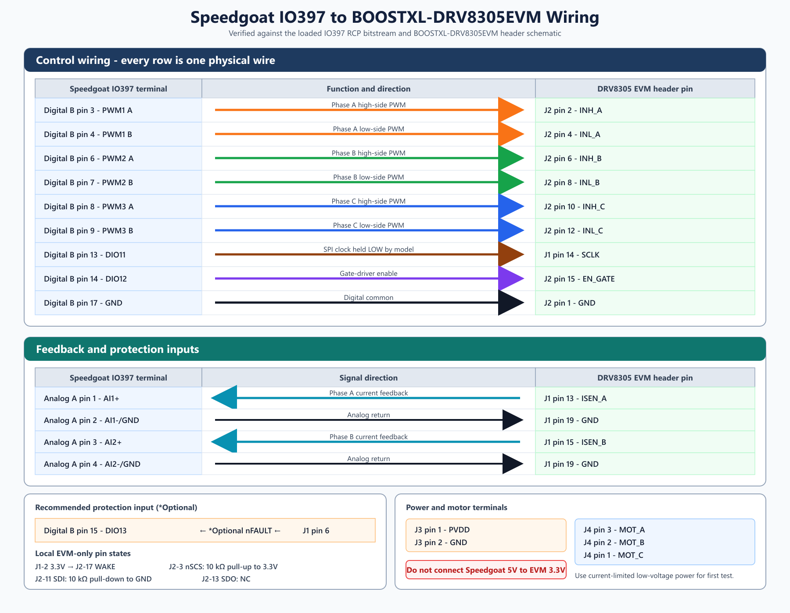
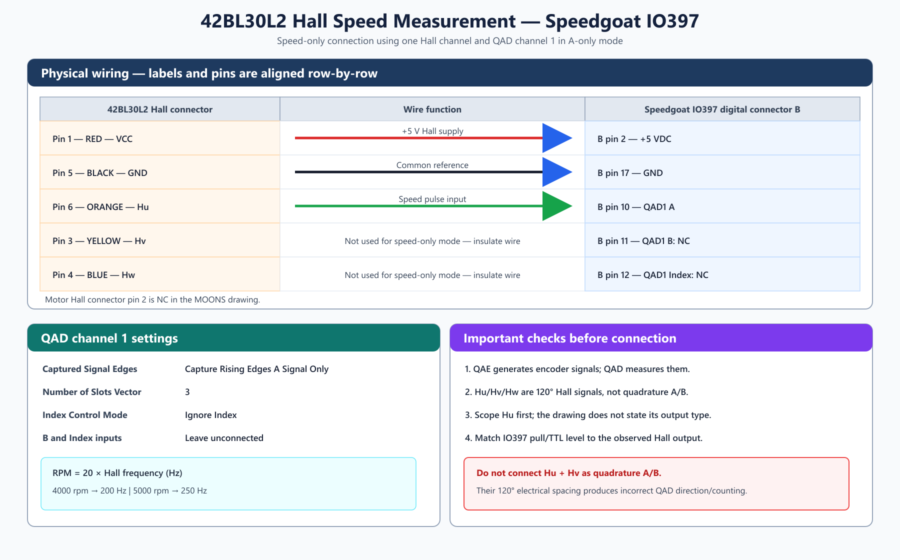

# Speedgoat IO397 to BOOSTXL-DRV8305EVM Wiring Interface

## Scope

This interface is based on the loaded Simulink model `speedgoat_IO397_RCP_BLDC_openloop`, the IO397 RCP configuration file `speedgoat_IO397_RCP.mat`, and the attached TI `BOOSTXL-DRV8305EVM User's Guide` (`DRV8305_pinout.pdf`).

The recommended initial configuration is open-loop, six-PWM control with phase-A and phase-B current feedback. It does not require SPI for the first low-voltage spin test, but SPI is recommended for production-quality diagnostics and gate-driver configuration.

## Required wiring

### PWM and enable

| Function | Speedgoat IO397 RCP terminal | Model assignment | BOOSTXL-DRV8305EVM connection |
|---|---:|---|---:|
| Phase A high PWM | Digital connector B, pin 3 | PWM channel 1, output A | J2 pin 2 - `INH_A` |
| Phase A low PWM | Digital connector B, pin 4 | PWM channel 1, output B, complement of A | J2 pin 4 - `INL_A` |
| Phase B high PWM | Digital connector B, pin 6 | PWM channel 2, output A | J2 pin 6 - `INH_B` |
| Phase B low PWM | Digital connector B, pin 7 | PWM channel 2, output B, complement of A | J2 pin 8 - `INL_B` |
| Phase C high PWM | Digital connector B, pin 8 | PWM channel 3, output A | J2 pin 10 - `INH_C` |
| Phase C low PWM | Digital connector B, pin 9 | PWM channel 3, output B, complement of A | J2 pin 12 - `INL_C` |
| SPI clock idle-low | Digital connector B, pin 13 | Digital output channel 11, permanently low | J1 pin 14 - `SCLK` |
| Gate-driver enable | Digital connector B, pin 14 | Digital output channel 12, driven by model data store `Enable` | J2 pin 15 - `EN_GATE` |
| Digital common | Digital connector B, pin 17 - GND | Common reference | J2 pin 1 - GND, or J1 pin 3/19 - GND |

Do not connect Speedgoat 5 V to the EVM 3.3 V pin. The model configures the IO397 digital banks for 3.3 V logic, which is compatible with the DRV8305 control inputs.

### Current feedback used by the model

| Function | BOOSTXL-DRV8305EVM source | Speedgoat IO397 terminal | Model assignment |
|---|---:|---:|---|
| Phase A current signal | J1 pin 13 - `ISEN_A` | Analog connector A, pin 1 - AI1+ | Analog input channel 1 |
| Phase A analog return | J1 pin 19 or pin 3 - GND | Analog connector A, pin 2 - AI1-/GND | AI1 return |
| Phase B current signal | J1 pin 15 - `ISEN_B` | Analog connector A, pin 3 - AI2+ | Analog input channel 2 |
| Phase B analog return | J1 pin 19 or pin 3 - GND | Analog connector A, pin 4 - AI2-/GND | AI2 return |

The model uses offsets of 1.6945 V and 1.6930 V and a gain of 14.286 A/V. The theoretical EVM conversion is `1 / (0.007 ohm x 10 V/V) = 14.2857 A/V`, so the gain is correct. Recalibrate the two offsets with the motor unpowered if the displayed currents do not read approximately zero.

## Recommended additional wiring (*Optional)

| Function | BOOSTXL-DRV8305EVM source | Suggested Speedgoat input | Reason |
|---|---:|---:|---|
| *Optional fault input | J1 pin 6 - `nFAULT` | Digital connector B, pin 15 - DIO channel 13 | Allows the model to disable `EN_GATE` after a DIO input block and trip logic are added |
| *Optional wake tie | J2 pin 17 - `WAKE` | Local jumper to EVM J1 pin 2 - 3.3 V, or a dedicated 3.3 V digital output | Guarantees recovery if the DRV8305 enters sleep |
| *Optional power-good monitor | J2 pin 9 - `PWRGD` | Spare input or oscilloscope | Confirms regulator and watchdog status |

The present model does not read `nFAULT` or `PWRGD`, so the *Optional `nFAULT` wire does not provide automatic shutdown until the input and trip logic are implemented. Digital output channel 11 appears at Speedgoat digital connector B pin 13 and is permanently low. It can therefore be connected to J1 pin 14 (`SCLK`) to enforce the required idle-low SPI clock state when SPI is unused.

### Unused SPI pins

If SPI is not implemented, do not leave the SPI inputs floating:

| DRV8305 signal | EVM pin | Recommended idle connection |
|---|---:|---|
| `SCLK` | J1 pin 14 | Hold low using Speedgoat DIO11 as configured, or a 10 kohm pull-down to GND |
| `SCS` / `nSCS` | J2 pin 3 | Hold high with a 10 kohm pull-up to EVM 3.3 V; do not ground it |
| `SDI` | J2 pin 11 | Hold low with a 10 kohm pull-down to GND |
| `SDO` | J2 pin 13 | Leave unconnected |

Using resistors instead of hard ties makes later SPI commissioning easier. `SCS` is active low, so holding it high is essential to keep the SPI interface deselected and prevent noise on `SCLK` from being interpreted as a transaction.

## Power and motor wiring

| Connection | BOOSTXL-DRV8305EVM terminal |
|---|---|
| DC supply positive | J3 `PVDD` |
| DC supply return | J3 `GND` |
| Motor phase A | J4 `MOT_A` |
| Motor phase B | J4 `MOT_B` |
| Motor phase C | J4 `MOT_C` |

For the MOONS 42BL30L2 motor, connect the three phase leads as follows for the initial open-loop test. This assignment establishes a starting phase order; if rotation is opposite to the command, change the commanded phase sequence rather than moving Hall wires.

| Motor connector pin / lead | Motor phase | BOOSTXL-DRV8305EVM |
|---|---|---|
| Pin 2, orange | `U` | J4 pin 3 - `MOT_A` |
| Pin 3, yellow | `V` | J4 pin 2 - `MOT_B` |
| Pin 1, blue | `W` | J4 pin 1 - `MOT_C` |

For first commissioning, use a current-limited low-voltage DC supply. The EVM is specified for 4.4 V to 45 V and up to 15 A RMS / 20 A peak, but the first test should be well below the final bus voltage and current limit.

## Model review findings

1. **PWM topology matches the driver.** The model uses one synchronized three-channel PWM block. Each channel produces A and complementary B outputs, matching the six DRV8305 inputs.
2. **PWM frequency is 20 kHz.** The PWM mode is symmetric/center-aligned.
3. **No FPGA deadband is configured.** `deadband = 0` and the block's A/B overlap protection is disabled. The DRV8305 contains handshake and programmable dead-time features, but the current model has no SPI path to verify or change the register setting. Configure and verify a suitable dead time before applying significant bus voltage.
4. **The bitstream has no SPI code module.** The loaded RCP image provides PWM, quadrature decoding, DIO, interrupt, ADC, and DAC only. The model therefore cannot read detailed DRV8305 faults or configure gate current/dead time over SPI. Add a compatible Speedgoat SPI-capable configuration, or configure the driver with a separate controller, if SPI control is required.
5. **Current sensing is consistent with the EVM.** The model's scaling matches the EVM shunt and amplifier values. Only phase A and B are acquired; phase C current is not connected.
6. **One unused model signal exists.** The `Mux` block in the Codegen subsystem has an unconnected output. This is a structural warning, not a wiring blocker.
7. **QAE is not the measurement block.** QAE generates encoder signals for simulation/HIL. The current model uses QAD, which decodes measured signals.
8. **The motor Hall signals are not quadrature A/B signals.** `Hu`, `Hv`, and `Hw` are 120-electrical-degree commutation signals. Do not connect `Hu` to QAD-A and `Hv` to QAD-B while the QAD block is set to `Capture A + B Signal`.

## 42BL30L2 speed-only Hall wiring

The current IO397 RCP bitstream can measure speed from one Hall channel using its QAD-A input. Use `Hu` as the pulse source and change only the QAD block settings shown below.

| 42BL30L2 Hall connector | Speedgoat IO397 terminal | Purpose |
|---|---|---|
| Pin 1, red - `VCC` | Digital connector B, pin 2 - `+5 V` | Hall sensor supply |
| Pin 5, black - `GND` | Digital connector B, pin 17 - `GND` | Hall and Speedgoat common reference |
| Pin 6, orange - `Hu` | Digital connector B, pin 10 - QAD channel 1 `A` | Speed pulse input |
| Pin 3, yellow - `Hv` | Not connected for speed-only measurement | Insulate the unused wire |
| Pin 4, blue - `Hw` | Not connected for speed-only measurement | Insulate the unused wire |
| Pin 2 | Not connected | No contact in the motor drawing |

Required QAD channel 1 settings:

- `Captured Signal Edges`: `Capture Rising Edges A Signal Only` (preferred for the clearest 3-pulse/revolution interpretation), or `Capture A Signal Only` if both edges are desired.
- `Number of Slots Vector`: `3`, because this 6-pole motor has 3 pole pairs and one Hall channel completes 3 cycles per mechanical revolution.
- `Index Control Mode`: `Ignore Index`.
- Leave Speedgoat digital connector B pins 11 (QAD-B) and 12 (QAD-index) unconnected for this speed-only configuration.

For one Hall channel, `RPM = 60 x fHall / 3 = 20 x fHall`. The expected Hall frequency is 200 Hz at the 4000 rpm rated speed and 250 Hz at the 5000 rpm maximum speed.

The motor drawing does not state whether the Hall outputs are push-pull or open-collector. The IO397 supports configurable 3.3 V or 5 V TTL pull levels. Start with the Hall sensors powered from 5 V and verify `Hu` with an oscilloscope before attaching it to B pin 10. If `Hu` is open-collector, select a suitable IO397 pull-up (or use an external pull-up); if it is a driven 5 V output, configure the IO397 input for 5 V TTL operation. Do not add a second pull-up until the output type is confirmed.

## Safe commissioning sequence

1. Power off the DC bus and keep `EN_GATE` low.
2. Verify continuity for GND, all six PWM wires, and the two current-sense returns.
3. Power the Speedgoat and confirm the six PWM outputs with an oscilloscope before connecting the motor power stage.
4. Confirm that each high/low pair is complementary and has adequate non-overlap at the DRV8305 inputs.
5. Apply a current-limited low DC-bus voltage with the motor disconnected; verify 3.3 V, `PWRGD`, and `nFAULT`.
6. Connect the motor, command zero amplitude, then assert `EN_GATE` only after valid PWM signals are present.
7. Increase amplitude and speed reference slowly while monitoring bus current and both current-sense channels.

## Source references

- TI `BOOSTXL-DRV8305EVM User's Guide`: pinout and header signals on pages 2 and 5; power and motor connection procedure on page 7; sensing circuits on page 8; GPIO/SPI description on page 9; complete schematic on page 11.
- [Speedgoat IO397 interface pin mapping](https://www.speedgoat.com/help/hdlcoder/page/refentry_interface_io397_front)
- [Speedgoat PWM Generation v5 documentation](https://www.speedgoat.com/help/archive/slrt_25a/9_11_1/page/io_main/refentry_pwm_generation_v5)
- [Speedgoat IO397 module specifications](https://www.speedgoat.com/products/simulink-programmable-fpgas-fpga-i-o-modules-io397)
- [Speedgoat quadrature decoder overview](https://www.speedgoat.com/products/simulink-program-fpga-code-module-quadrature)
- [MOONS 42BL30L2 product page](https://www.moonsindustries.com/p/s42-series-brushless-dc-motors/42bl30l2-000004611130000001)
- [TI DRV8305 datasheet](https://www.ti.com/lit/ds/symlink/drv8305.pdf)

